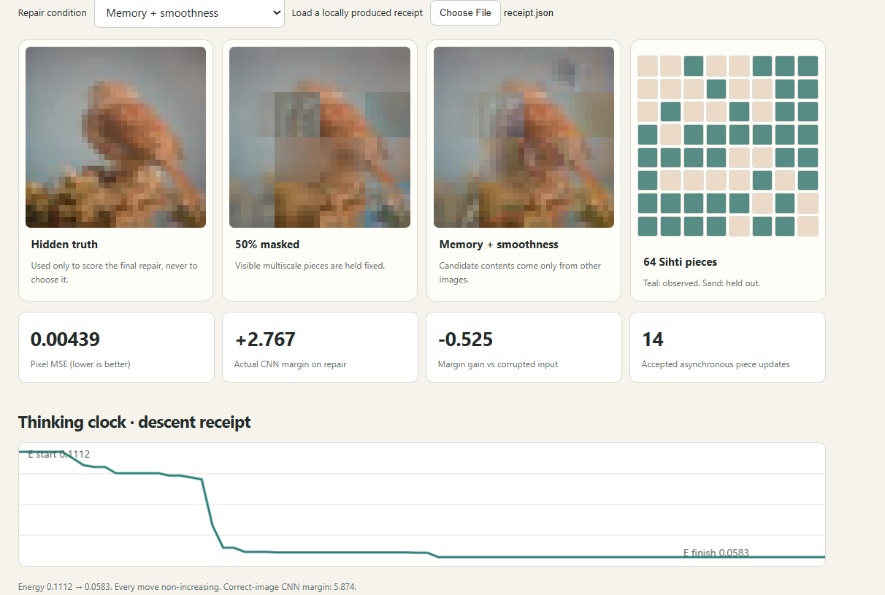

# DoDis

**Memory supplies possible content. Learned relationships test whether it fits. A separate classifier contributes a measurable preference.**

[**Explore the live experiment**](https://anttiluode.github.io/DoDis/) · [Experimental protocol](PREREG.md) · [Source code](dodis.py) · [Evaluation runner](run.py)

DoDis is an experimental image-completion system built around **three distinct sources of information**. Its question is whether learned relations between multiscale image components improve the reconstruction of genuinely withheld information—and what happens when a classifier is allowed to influence the result.

Unlike a static image-attribution map, the system has to **propose real replacement content**. It draws that content from stored images, not from a classifier score. The final reconstruction is evaluated against ground truth that the solver never sees.

**Status:** A first controlled experiment on 12 held-out CIFAR-10 birds is complete. Learned binding provides a small improvement in reconstruction error; classifier guidance substantially raises the bird-class margin while worsening the reconstructed image relative to binding alone. This is a research prototype, not a production inpainting or generative model.

## How it works

A 32×32 RGB image is decomposed into **64 additive Sihti components**: four Laplacian-like scales, each subdivided into 4×4 spatial tiles. Adding all pieces back to the fixed mean-color base reconstructs the image up to floating-point error. Each piece is independently hidden with probability 0.5; observed pieces remain fixed during repair.

Three systems have independent responsibilities:

| System | Information source | What it contributes |
|---|---|---|
| **Content memory** | 256 separate training birds | Real candidate pieces retrieved using only visible pieces |
| **Consistency graph (A)** | 320 other training birds, no CNN supervision | 80 statistical relations between nearby and cross-scale image components |
| **Purpose graph (B)** | A third training set of 600 images plus 140 validation images | A shared surrogate for a frozen CNN's bird-vs-competing-class logit margin |

For every hidden component, the solver considers pieces from the nearest donor images, plus a blank candidate. Its explicit energy combines donor-memory preference, tile-boundary smoothness, learned binding and optionally the classifier-purpose score:

\[
E(c) = E_{\mathrm{memory}}(c) + E_{\mathrm{seams}}(c)
       - \gamma S_{\mathrm{binding}}(c)
       - \lambda \widehat{m}_{\mathrm{CNN}}(c)/\sigma_m .
\]

The choices \(c\) select donor pieces. The purpose term is absent when \(\lambda = 0\). It is a surrogate for a CNN decision margin, **not a probability that an image is correct**. Nor is it capable of supplying missing pixel content.

An asynchronous coordinate-descent solver enumerates candidates for one hidden piece at a time and accepts only energy-reducing updates. This guarantees that its **defined optimization energy is non-increasing**, not that reconstruction error decreases.

## Results: 12 held-out birds

The CIFAR-10 test images were not used for memory storage, consistency-graph training or purpose-graph fitting. All four experimental conditions used the same observed pieces, candidate donors and update order.

**Primary measurement:** whole-image pixel mean squared error (MSE), lower is better. **Secondary measurement:** the actual frozen CNN's bird margin, higher is more confidently bird-like.

| Completion condition | Mean pixel MSE ↓ | Mean actual CNN bird margin ↑ | Birds with lower MSE than memory-only |
|---|---:|---:|---:|
| Memory + smoothness | 0.01494 | −0.590 | Baseline |
| **Memory + learned binding** | **0.01417** | −0.003 | **9 / 12** |
| Memory + shuffled-binding control | 0.01438 | −0.339 | 7 / 12 |
| Memory + binding + CNN-purpose graph | 0.01482 | **+1.578** | 7 / 12 |

These are measured aggregate results from the [published experimental receipt](docs/receipt.json). The controls and parameters were specified in [PREREG.md](PREREG.md) before the run.

**Interpretation:**

- Learned binding lowers mean pixel MSE by **5.2%** relative to memory plus smoothness and by approximately **1.5%** relative to a shuffled-binding graph. The effect is small and based on only 12 images.
- Adding classifier purpose increases the *actual* CNN's mean bird margin by about **1.58 logit units** relative to binding alone, but makes the reconstruction approximately **4.6% worse in MSE**. A classifier's preference need not correspond to the true missing content.
- The purpose surrogate reaches independent validation **R² = 0.366**. It is a limited approximation; its predictions must not be confused with the actual CNN score.
- All recorded solver trajectories were non-increasing in the defined energy. This is a solver correctness check, not a proof of correct reconstruction.

The published example, test bird #113, shows why paired per-image results matter: its learned-binding completion has *slightly worse* pixel MSE than memory-only, despite the improved aggregate mean. The small gains require further replication.

### Interactive results viewer

The [GitHub Pages viewer](https://anttiluode.github.io/DoDis/) displays a measured test bird, the corrupted image, four reconstructed alternatives, and the corresponding energy-descent traces. A dropdown switches between experimental conditions and updates the image, MSE, actual CNN margin and accepted update count.

The [page receipt](docs/receipt.json) contains **one example image and aggregate metrics**. The full per-bird data and optimization traces are produced locally at the path **runs/v1/results.json**; that file is not currently committed to the repository. The site is a scientific readout, not a live webcam or browser-based GPU solver.

## Reproduce the experiment

**Requirements:** Python 3.11 or later, compatible PyTorch and Torchvision, NumPy, Pillow, and the CIFAR-10 dataset. DoDis uses the frozen TinyCNN model from [SihtiGraphModel](https://github.com/anttiluode/SihtiGraphModel), including its committed model checkpoint. A CUDA-capable GPU is useful but is not required.

Clone the two public repositories into sibling folders:

~~~bash
git clone https://github.com/anttiluode/SihtiGraphModel.git
git clone https://github.com/anttiluode/DoDis.git
python -m pip install -r DoDis/requirements.txt
~~~

Download CIFAR-10 once into the directory used by SihtiGraphModel:

~~~bash
cd SihtiGraphModel
python -c "from torchvision.datasets import CIFAR10; CIFAR10('data', train=True, download=True); CIFAR10('data', train=False, download=True)"
cd ../DoDis
~~~

Run the instrument tests, then the full experiment:

~~~bash
python -m unittest discover -s tests -v
python run.py --sihti-root ../SihtiGraphModel --device auto
~~~

Use **--device cuda** to require an installed CUDA-enabled PyTorch, or **--device cpu** to force CPU. No CNN training or retraining is performed. For an alternative folder layout, point **--sihti-root** at the SihtiGraphModel checkout.

The experiment generates two files:

- **runs/v1/results.json** — complete per-test-bird statistics, energy trajectories, donor provenance and aggregate comparisons (not committed by default).
- **docs/receipt.json** — the first bird's images and energy traces plus measured summary numbers, suitable for GitHub Pages.

To inspect a new run without publishing it, open the web page and choose **Load a locally produced receipt**. Publishing an updated receipt requires committing the generated docs/receipt.json to a repository or fork with Pages enabled.

## Scientific limits

The task hides **random multiscale components**, not a rectangular hole in a photograph. All images are small CIFAR-10 samples and the evaluation selects birds that the existing CNN recognizes correctly before corruption. Donor coverage matters, and all candidate replacements come from other images.

The consistency matrices model statistical co-occurrence, not a calibrated generative image distribution or a recovered biological circuit. The CNN-purpose graph is discriminative; optimizing its score may create misleading or unnatural results. Graph A's candidate connections were restricted to spatial neighbors and certain octave pairs rather than all possible interactions.

The experiment covers only 12 test birds with fixed weights and one seed. The published web receipt does not contain the complete per-image arrays required to compute paired confidence intervals. The reported improvements are **preliminary measurements**, not established population-level performance.

The next decisive tests are more held-out images and seeds, paired uncertainty estimates, stronger donor-only controls, and direct measurement of whether learned bindings recover truly missing image content.

## Project context and license

DoDis follows [SihtiGraphModel](https://github.com/anttiluode/SihtiGraphModel), which studied multiscale graph representations of a CNN's responses. The system is also inspired by recurrent visual-memory experiments, but this repository implements an independent, offline, measurable reconstruction test.

Distributed under the terms of the repository [LICENSE](LICENSE).
